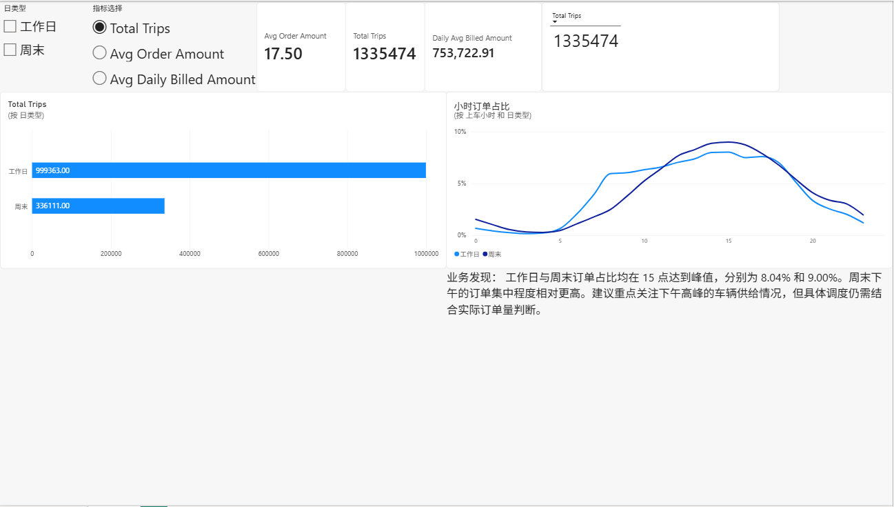

# NYC Yellow Taxi 数据分析与可视化

## 1. 项目背景与目标

本项目基于 2021 年 1 月纽约黄色出租车（NYC Yellow Taxi）订单数据，研究不同时段的出租车订单需求变化。

重点分析工作日与周末、不同小时的订单量、账单金额以及行程效率，识别出行需求特征，为后续运力资源配置提供数据参考。

项目主要使用 PostgreSQL 和 SQL 进行数据清洗与质量检查，利用 Python/Pandas 开展业务分析，最终通过 Power BI 制作交互式数据看板，展示主要分析结果。

## 2. 数据来源与清洗

### 2.1 数据来源

本项目使用纽约市出租车与豪华轿车委员会（NYC TLC）发布的 2021 年 1 月黄色出租车订单数据。

- 原始数据量：1,369,765 条记录
- 数据内容：上车时间、下车时间、行程距离、账单金额等字段
- 官方数据来源：[NYC TLC Trip Record Data](https://www.nyc.gov/site/tlc/about/tlc-trip-record-data.page)

### 2.2 数据清洗

使用 PostgreSQL 对原始数据进行质量检查，重点分析行程距离、行程时长和金额等字段的异常情况。

通过 SQL 创建 `yellow_taxi_clean_v1` 清洗视图，对异常数据进行状态标记，并保留原始记录，方便后续检查和筛选。

清洗过程中，根据异常类型和严重程度进行区分，避免仅因单个字段异常就直接删除整条记录。

### 2.3 最终分析数据

根据目标月份、有效行程距离、行程时长和非负金额等条件进行筛选，最终导出 **1,335,474 条业务分析记录**，保存为：

`taxi_business_jan2021.csv`

未进入最终分析的数据不一定全部属于异常订单，也可能不符合本项目的统计范围。

## 3. 核心业务发现

### 3.1 工作日与周末的订单需求

2021 年 1 月：

- 工作日日均订单量约为 **47,589 笔**
- 周末日均订单量约为 **33,611 笔**
- 工作日比周末高约 **41.59%**

由于工作日共有 21 天、周末共有 10 天，因此采用日均订单量进行比较，避免直接比较累计订单数造成的误导。

这一结果说明，在本项目分析的时间范围内，工作日的出租车订单需求明显高于周末。

### 3.2 平均单笔账单金额分析

- 工作日平均单笔账单金额约为 **17.39 美元**
- 周末平均单笔账单金额约为 **17.81 美元**

虽然工作日日均订单量更高，但周末的单笔账单金额略高。

这一差异可能与周末休闲、出游等出行需求有关，但目前没有直接验证乘客的出行目的，因此不能确定具体原因。

### 3.3 行程效率分析

通过计算行程速度，并按照工作日与周末、不同小时进行分组，使用速度中位数观察不同时段的行程效率差异。

主要发现：

- 工作日 14 点的行程速度中位数约为 **10.36 mph**
- 周末 15 点的行程速度中位数约为 **11.86 mph**

这一结果仅说明对应时段的样本行程速度存在差异，不能直接判断道路拥堵程度，因为行程速度还可能受到路线类型、行程距离、交通信号和停车情况等因素影响。

## 4. Power BI 可视化

本项目使用 Power BI Desktop 构建交互式数据看板，展示 2021 年 1 月纽约黄色出租车的主要业务指标。

看板主要包含：

- **核心 KPI**：总订单量、平均单笔账单金额和日均账单金额。
- **工作日与周末对比**：通过动态柱状图比较不同日期类型的业务指标。
- **小时订单占比**：通过折线图展示工作日与周末在不同时段的订单分布。
- **动态交互**：使用日期类型切片器和字段参数，实现日期类型筛选及指标切换。

Dashboard 文件：`NYC_Taxi_Dashboard_V2.pbix`

### Dashboard 展示



## 5. 项目复现

### 5.1 项目文件结构

```text
NYC-Taxi/
├── README.md
├── taxi_clean_v1.sql
├── taxi_business_jan2021.csv
├── taxi_hourly_analysis.py
├── taxi_hourly_plot.py
├── taxi_amount_analysis.py
├── taxi_trip_efficiency.py
├── taxi_hourly_demand.csv
├── taxi_hourly_demand.png
├── taxi_trip_efficiency_hourly.csv
├── NYC_Taxi_Dashboard_V2.pbix
└── images/
    └── dashboard_overview.png
```

### 5.2 环境准备

本项目使用：

- PostgreSQL：原始数据存储与 SQL 数据清洗
- Python：数据分析与处理
- Pandas：数据读取、分组聚合与统计分析
- NumPy：异常数据分类与数值处理
- Matplotlib：数据可视化
- Power BI Desktop：交互式数据看板

准备 Python 环境后，安装相关依赖：

```bash
pip install pandas numpy matplotlib
```

### 5.3 使用已有业务数据进行分析

如果已经获得清洗后的 `taxi_business_jan2021.csv`，可以直接使用 Python/Pandas 进行分析，无需重新运行 SQL 清洗。

在项目根目录下，根据分析需求运行以下脚本：

```bash
python taxi_hourly_analysis.py
```

分析工作日与周末的小时订单需求，生成 `taxi_hourly_demand.csv`。

```bash
python taxi_hourly_plot.py
```

读取小时需求分析结果，生成小时订单需求可视化图表 `taxi_hourly_demand.png`。

```bash
python taxi_amount_analysis.py
```

分析不同日期类型的账单金额、平均单笔账单金额及不同时段的账单变化。

```bash
python taxi_trip_efficiency.py
```

分析不同时段的行程效率，生成 `taxi_trip_efficiency_hourly.csv`。

各分析脚本可以根据需求分别运行。

最后使用 Power BI Desktop 打开 `NYC_Taxi_Dashboard_V2.pbix`，检查数据源路径，必要时更新路径并刷新数据。

### 5.4 从原始数据开始复现

如果需要从原始数据开始完整复现：

1. 从 NYC TLC 官方数据页面下载 2021 年 1 月 Yellow Taxi 原始数据。
2. 将原始数据导入 PostgreSQL。
3. 运行 `taxi_clean_v1.sql`，创建 `yellow_taxi_clean_v1` 清洗视图。
4. 根据项目使用的筛选口径，从清洗视图导出业务分析数据。
5. 将导出的数据保存为 `taxi_business_jan2021.csv`。
6. 按照 5.3 节运行 Python 分析脚本。
7. 使用 Power BI Desktop 打开看板，检查数据源并刷新。

注意：原始数据导入方式、数据库连接配置及 SQL 导出语句需要结合实际环境进行设置。

## 6. 分析局限与改进方向

### 6.1 分析局限

1. **数据时间范围有限**：本项目仅分析 2021 年 1 月的出租车订单，分析结果可能受到季节和疫情期间出行情况等因素影响，不能直接代表全年出行规律。

2. **账单金额不等于平台收入**：`total_amount` 表示订单账单总额，不能直接用于衡量出租车平台的实际利润或净收入。

3. **行程速度不能直接代表道路拥堵**：行程速度受到路线类型、行程距离、交通信号和停车情况等因素影响，需要结合更多交通数据才能分析道路拥堵程度。

4. **缺少车辆供给数据**：目前主要分析订单需求，缺少司机数量、车辆分布和乘客等待时间等信息，因此不能直接确定最优运力配置方案。

### 6.2 后续改进方向

1. **扩大分析时间范围**：引入更多月份的数据，研究出租车需求的季节性变化。

2. **完善业务分析维度**：结合上下车位置、行程距离等信息，进一步分析不同区域的出行特征。

3. **支持运力配置分析**：结合车辆供给、乘客等待时间等数据，研究不同时段的供需关系，为运力调整提供更充分的依据。